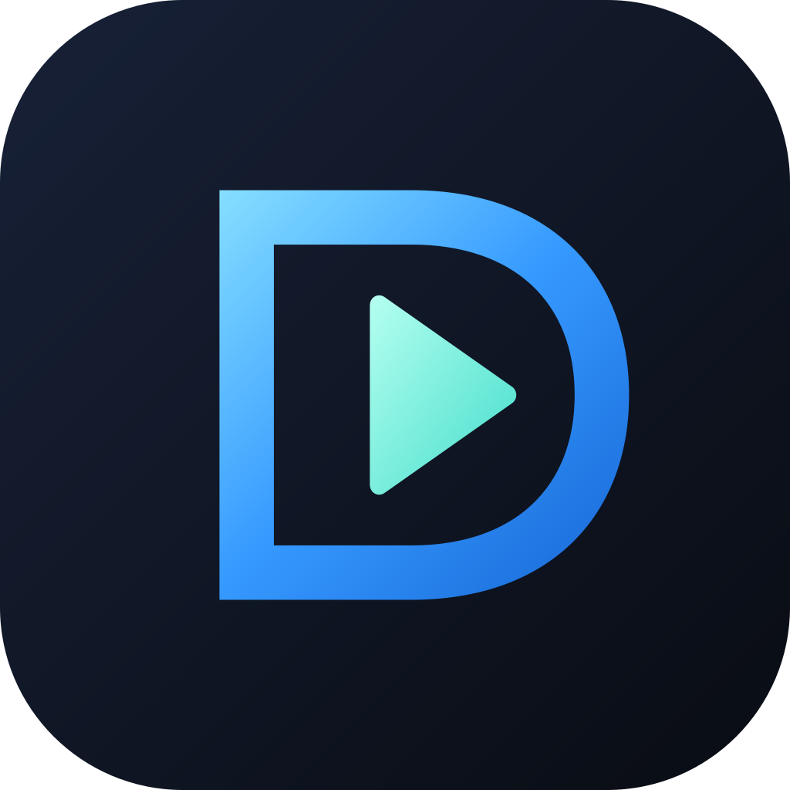

# DD Player icon family



Issue [#20](https://github.com/jimbobsmith/drivedeck-player/issues/20), approved by the maintainer on 2026-10-20. The original DD D-frame/play artwork distinguishes this PipePipe-derived app from upstream. The Android member uses a blue/cyan frame and mint play mark; its FreeTube-derived desktop sibling uses violet and ice white. These are provisional product assets under this repository's existing licence.

## Source and generation

`dd-player.svg` is the editable approved 108-unit artwork (1024px output). `tv-banner.svg` is generated from it. The existing PipePipe/NewPipe credits, licences, package IDs, Test label, player, sync and dependency pins remain as recorded in the foundation documentation.

Run asset generation with Node and an independently provided Sharp module; no runtime or build dependency is added:

```powershell
node tools/branding/generate.cjs <absolute-path-to-sharp-module>
```

This writes all five legacy density icons (48/72/96/144/192px), transparent adaptive foregrounds (108/162/216/324/432px), the monochrome vector and the 320x180 TV banner. The banner uses Segoe UI when rendering on the evidence host; an alternate host needs that font for identical banner pixels. Sharp 0.35.5 / librsvg 2.63.2 / Node 24.18.0 produced the recorded assets. The script is opt-in authoring tooling; ordinary Android builds consume committed assets.

The adaptive icon uses a full-bleed vector gradient background and a separate transparent foreground. An additional 0.8 inset keeps the complete mark inside the 66-unit safe circle on the 108-unit layer. The Android monochrome layer contains opaque paths only: the launcher supplies its tint and background. Legacy icons retain the approved rounded tile. The existing notification accent resource now uses the icon's blue rather than upstream red. Unused upstream splash/logo assets are retained.

## Validation

See [evidence.json](evidence.json) for source/tool/artifact hashes and the measured checks. The proportional Android recipe is:

```powershell
# Pinned JDK 25, SDK 37.0 and Gradle 9.5.1, using the foundation cache/toolchain.
gradle :app:assembleDebug :app:testDebugUnitTest :app:writeFoundationRuntimeAudit --no-configuration-cache --no-daemon --max-workers=2 --console=plain
./tools/foundation/audit-apk.ps1 -Apk app/build/outputs/apk/debug/DriveDeckPlayer_0.1.0-alpha01-arm64-v8a-debug.apk -SdkRoot <sdk> -OutputDirectory <disposable-directory>
```

Checks cover density dimensions/alpha, the adaptive safe circle, visual inspection of legacy/circle/squircle/monochrome/small variants and banner, compiled resource references, packaged PNGs, Test identity, backup and dependency boundaries. Regeneration is checked for identical outputs. No playback, permission, identity, dependency or sync source is changed by this task.

Actual launcher caching/tint/animation and TV home-screen presentation remain unobserved field checks. No personal-device installation, signing or publication is included. A build or mask preview does not certify those OS surfaces or repeat earlier playback/A/V/sync validation.
